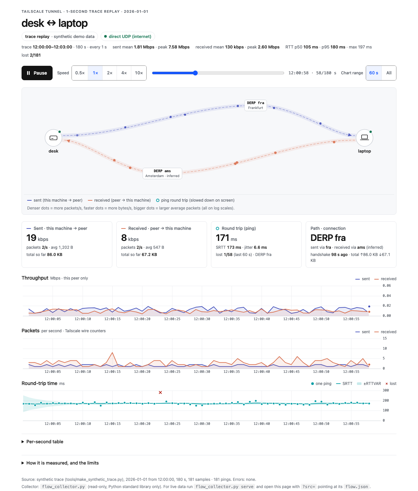
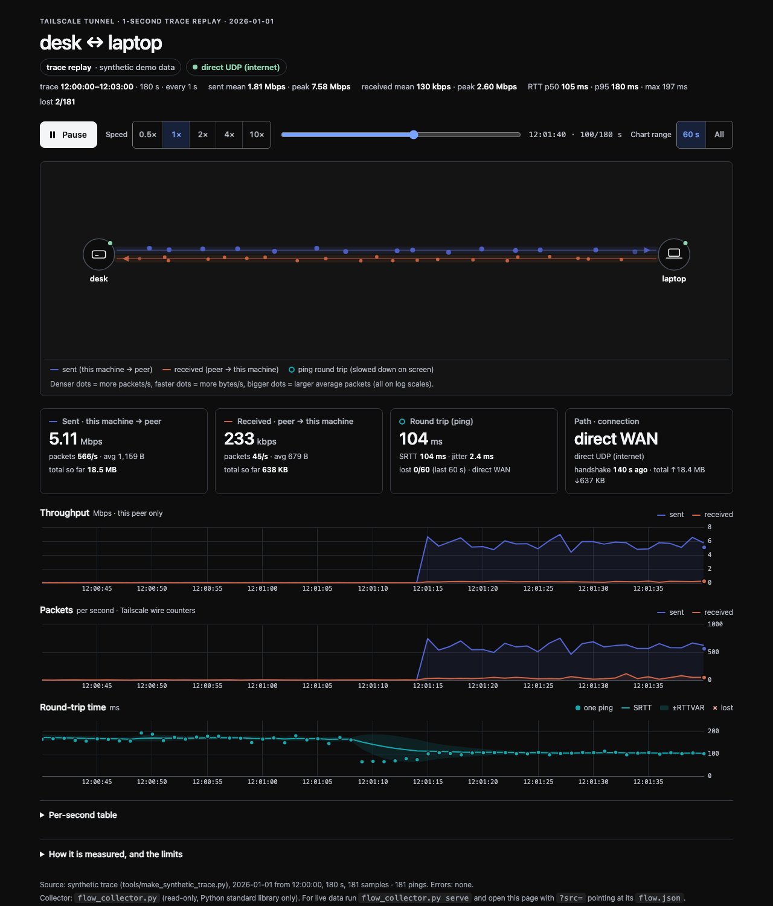

# tailscale-flow

**See what your Tailscale link to one other machine is doing, right now: direction, bandwidth, packets, round-trip time, and whether it goes direct or through a DERP relay.**

One HTML page and one read-only Python collector that uses only the `tailscale` CLI. It works on the free Tailscale plan, needs no API key and no extra dependencies (Python standard library only).



<details><summary>Dark mode, after the path switched to a direct connection</summary>


</details>

The screenshots show the bundled **synthetic** demo trace (`demo/synthetic-trace.json`, generated by `tools/make_synthetic_trace.py`). No real network data is included in this repository.

## Quick start

```sh
git clone https://github.com/MLEARNER701/tailscale-flow.git
cd tailscale-flow

# 1. Look at the demo: open the page, it replays the embedded synthetic trace
open tailscale-flow.html            # macOS; or xdg-open on Linux

# 2. Live: watch the link to one peer (its MagicDNS short name from `tailscale status`)
python3 flow_collector.py --peer my-laptop serve --port 8791
# then serve the page from the same origin, e.g. in another terminal:
python3 -m http.server 8000 --bind 127.0.0.1
# and open http://127.0.0.1:8000/tailscale-flow.html?src=http://127.0.0.1:8791/flow.json
# (cross-origin: start the collector with --cors http://127.0.0.1:8000)

# 3. Record a trace and replay it later (keep personal recordings out of public copies)
python3 flow_collector.py --peer my-laptop record --seconds 180 --out my-trace.json
python3 tools/embed_trace.py my-trace.json --out my-flow.html
```

Collector modes:

| Mode | What it does |
|---|---|
| `once` | Two samples one second apart and one ping, printed as `tsflow.v1` JSON |
| `record --seconds N --out F` | Samples every second for N seconds and writes a trace file |
| `serve --port P` | `GET /flow.json[?since=t]` on 127.0.0.1 only; samples only while someone is polling (stops after `--idle` seconds) |

Every second it runs `tailscale status --json`, `tailscale metrics print` and `netstat -ib`, and a `tailscale ping -c 1` in its own loop. It never changes Tailscale settings. Public IPs and tailnet IPs are never written; a direct endpoint is reduced to `lan` or `wan`. The JSON schema is documented at the top of `flow_collector.py`.

Page URL parameters: `?src=<url of flow.json>` for live mode, `?t=<seconds>` to start a replay at an offset.

## How it differs from tsflow

[tsflow](https://github.com/rajsinghtech/tsflow) is the best-known Tailscale traffic visualiser. The two answer different questions:

| | tailscale-flow | tsflow |
|---|---|---|
| Scope | one link: this machine ↔ one peer | the whole tailnet |
| Data source | local `tailscale` CLI (status, metrics, ping) | Tailscale Network Flow Logs via the API |
| Plan / credentials | any plan, no API key | Premium or Enterprise plan, OAuth client or API key |
| Shows | per-second bandwidth, packets, RTT with SRTT/RTTVAR, DERP vs direct path and the relay region | device graph, flows, ports and protocols |
| Install | one Python file + one HTML file | Homebrew, Docker, binary, Kubernetes |

**What tsflow does better:** it sees every device and every flow in the tailnet, keeps history in SQLite with retention, has analytics (top talkers, ports, protocols), filtering and time ranges, multi-tailnet support, Prometheus metrics and an MCP endpoint. tailscale-flow has none of that; it is a close-up instrument for one link, not a network monitor.

## Limitations

- One peer at a time, seen from the machine running the collector. The reverse DERP path is inferred (packets go to the receiver's home DERP region), not observed.
- Packet counters from `tailscale metrics` are summed over all peers; the page attributes them to the chosen peer by its share of bytes in that second, which is an estimate when other peers are busy.
- `netstat -ib` utun counters are parsed in the macOS format; on Linux those columns stay empty (bytes, packets from metrics and RTT still work).
- Tested with the Tailscale 1.9x CLI on macOS. CLI output formats can change between releases.
- `serve` has no authentication and binds to 127.0.0.1 by default. If you expose it on your tailnet, every device that can reach it can read the throughput and RTT figures.
- The animation is a log-scaled metaphor: one dot is not one packet.

## Tests

```sh
python3 -m unittest discover -s tests -v
```

The tests run offline (no Tailscale needed): parsers, the RTT estimator, the synthetic trace, and a check that the page embeds exactly the synthetic trace. CI runs the same command.

## 한국어 안내

**tailscale-flow**는 이 컴퓨터와 다른 기기 한 대 사이의 Tailscale 연결을 1초 단위로 보여 주는 페이지입니다. 보내기·받기 대역폭, 패킷 수, 왕복 지연(SRTT·RTTVAR 포함), 그리고 지금 직결인지 DERP 중계를 거치는지(어느 지역 중계인지)를 애니메이션과 그래프로 표시합니다.

- `tailscale` CLI만 읽습니다(읽기 전용). 무료 플랜에서 동작하고 API 키나 추가 패키지가 필요 없습니다.
- 빠른 시작: `tailscale-flow.html`을 열면 합성 데모 기록을 재생합니다. 실시간으로 보려면 `python3 flow_collector.py --peer <기기 이름> serve`를 실행하고 페이지 주소에 `?src=<flow.json 주소>`를 붙입니다.
- tsflow와의 차이: tsflow는 유료 플랜의 Network Flow Logs로 tailnet 전체를 보여 주고, 이력 저장·분석·필터 기능이 훨씬 많습니다. tailscale-flow는 연결 하나를 가까이 보는 도구이고, 그 대신 무료 플랜과 CLI만으로 지연 시간과 경로 변화를 보여 줍니다.
- 한계: 한 번에 피어 하나만 봅니다. 반대 방향 DERP 경로는 추정입니다. 패킷 수는 전체 피어 합계를 바이트 비율로 나눈 추정치입니다. macOS에서 시험했습니다.
- 이 저장소의 화면과 기록은 모두 합성 데이터입니다. 직접 기록한 trace에는 기기 이름과 DERP 지역이 들어 있으니 공개 저장소에 올리지 마십시오.

## License

[MIT](LICENSE)
